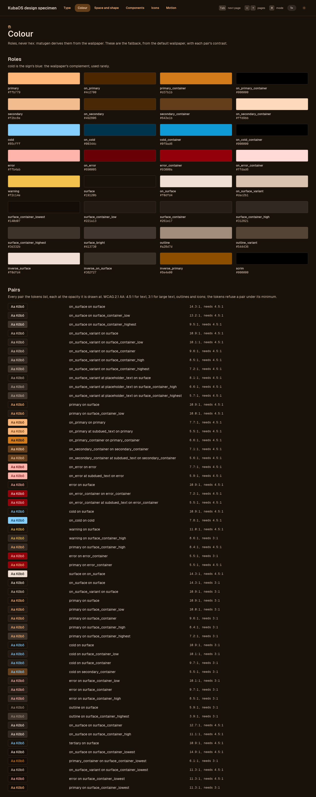
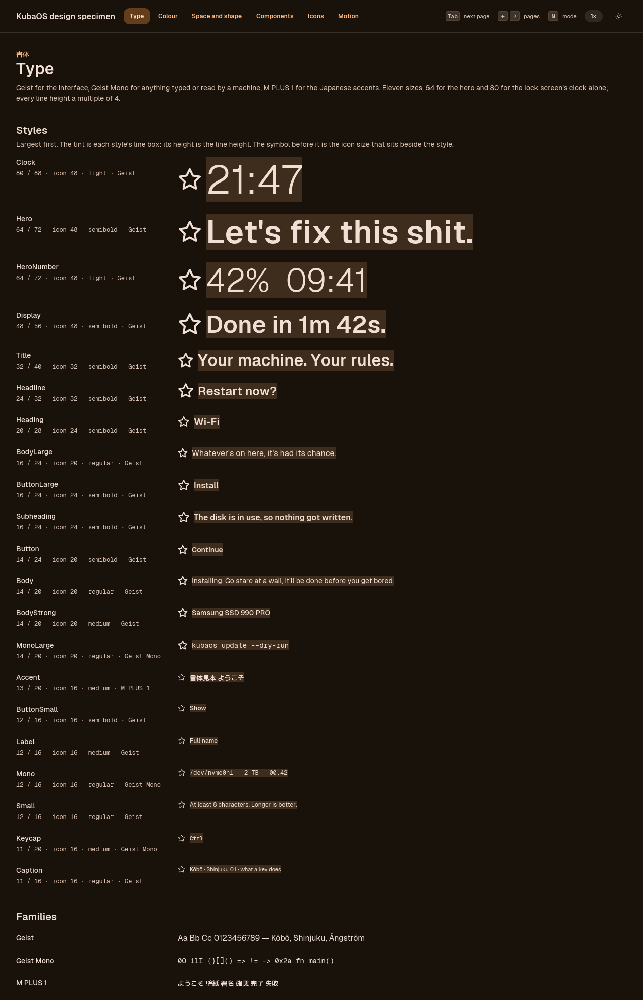
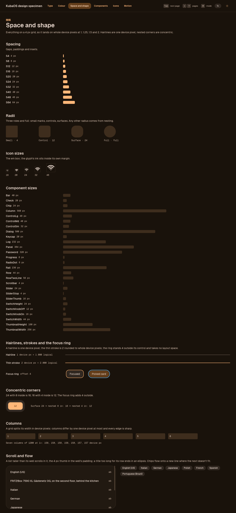
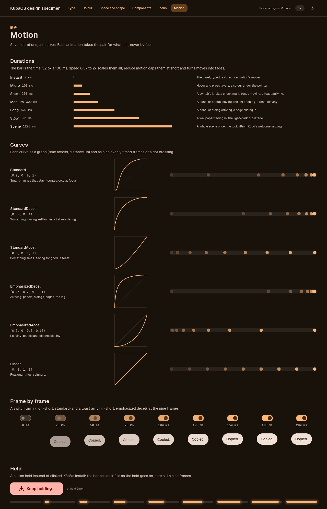
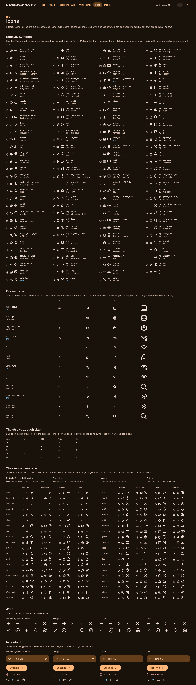
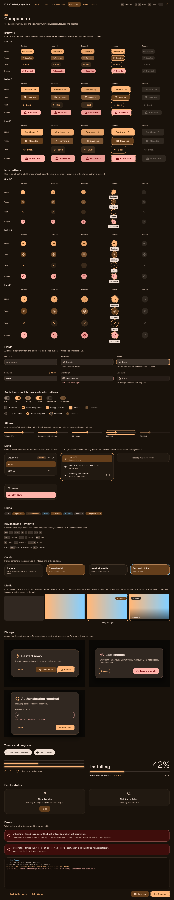

# KubaOS: look and behaviour

How every KubaOS surface looks and behaves: the shell, the Command menu, Kōbō, the apps to come, the terminals, Plymouth and GRUB. Agents: read this before you build or change anything a person sees, in any toolkit. A rule here has a reason and a picture; follow the rule, and when the reason doesn't fit your case, change the rule here for everyone (see "Changing the design") instead of working round it.

Three files hold the design, each owning one thing:

| File | Owns |
|---|---|
| `design/tokens.toml` | Every value: colour roles, lengths, type styles, durations, curves, opacities, shadows, the list of symbols. `kubaos-tokens` checks its rules and writes each toolkit's copy: `kubaos-ui`'s `tokens.rs`, and `Tokens.qml` and `Symbols.qml` in `KubaOS.Components`. |
| `docs/DESIGN.md` (this file) | The rules and their reasons: which value is for what, the components, the keyboard, focus, scaling. |
| `docs/BRAND.md` | The words: name, voice, and how errors and buttons read. |

A rule marked *Not enforced yet* is decided but not built: no code follows it today. The marker names the issue that builds it, or says that none does yet. Every other rule here is what the code does.

Values below are shown so this file reads on its own. Each one names its token, and the token wins: when they disagree, `design/tokens.toml` is right and this file is stale.

The pictures are the specimen, `kubaos-specimen`, which draws every token and component with `kubaos-ui`. The 1× shots are checked in under `design/specimen/`; `kubaos-specimen shots DIR` renders all of them at 1, 1.25, 1.5 and 2, light and dark. The Command menu's "Design specimen" Item opens it live.

## Principles

In priority order: when two conflict, the higher one wins.

1. **Details.** Every pixel is decided, including the ones nobody sees. An edge between two device pixels, a gap that is 13 instead of 12, an icon half a pixel off centre: each is a bug, and the checks below fail on them.
2. **Fast.** Performance is a feature. Every frame lands on time at the display's full refresh rate; a dropped frame is a bug and is measured, not guessed at.
3. **Simple.** One way to do a thing. A closed set of components and values, so the choice is small.
4. **One thing.** Every surface, in every toolkit, is the same surface: the same names, sizes, colours, keys and motion in iced and QML.
5. **Keyboard first.** Everything the mouse does, keys do, with a visible focus ring. The mouse works; you never need it.
6. **Quiet until needed.** Nothing moves, blinks or pops up unless it has something to say. Notifications are for what you'd want to be interrupted for.
7. **Your windows are yours.** KubaOS never resizes, moves or covers your windows on its own. Panels float over them and go.
8. **For devs and users.** Dense, never cramped: the information a developer wants, at sizes everyone can read.

## Reference look

Kōbō is the reference. Kuba designed it; the shell's look was inherited from someone else's config. Every front end aligns towards Kōbō. Its look became `kubaos-ui`, its own drift (off-grid paddings, hand-made buttons) fixed on the way, and Kōbō is now built from `kubaos-ui` alone: every install and setup screen is the components below, held to the geometry check at every scale, light and dark (see "Checks"). When a shell surface and Kōbō disagree on something this file doesn't settle, Kōbō is right until this file says otherwise.

## Colour



*The roles as swatches, then each foreground and background pair with its contrast ratio and the minimum it needs. Light: [colour-light-1x.png](../design/specimen/colour-light-1x.png).*

- **Roles, never hex.** Code names a role (`primary`, `on_surface`, `surface_container_high`, `error`, `cold`, `warning`), never a colour. The roles are Material 3's, plus `cold` and `warning`. The palette changes with the wallpaper, so a hex value in a component is wrong the moment the wallpaper changes.
- **Matugen derives them from the wallpaper** (`scripts/dot-theme`, `scheme-fidelity`). `[color.source]` in the tokens names the matugen colour each role comes from. `[color.dark]` and `[color.light]` are the fallback: matugen's output for the default wallpaper, used until a theme exists and in the specimen.
- **Cold accent** (`cold`, from matugen's tertiary): the blue of the sign's dakuten. With `scheme-fidelity` tertiary is the wallpaper's complement, so cold follows the wallpaper. Use it rarely: the focus ring on picked cards, where the accent already means picked, and a demo or preview badge. It is never a second primary. It is configurable: the complement is the default, and the user may pick another. *Not enforced yet: lands in #154.*
- **Warning** is ours (Material 3 has none): amber between fine and the error colour, for a reading close to its limit. It keeps its value whatever the wallpaper; the light one is dark enough for text on light surfaces.
- **Contrast minimums** (WCAG 2.1 AA, `kubaos_ui::color::Contrast`): 4.5:1 for body text and labels; 3:1 for large text (24 px and up, or 19 px semibold and up) and for icons, outlines and other shapes that carry meaning. Decoration (a divider, a well's edge, a disabled control) carries no meaning and has no minimum, as WCAG exempts it.
- **Every pair is listed and checked.** `[contrast]` in the tokens lists every foreground role the front ends draw on a background role, at the opacity it is drawn at, with what it needs and where it is drawn. `kubaos-tokens` refuses a pair under its minimum in either fallback palette, `kubaos-ui`'s tests hold it, and `kubaos-design contrast` lists every pair with its ratio (see "Checks"). A new pairing adds its line there in the PR that draws it. The fixes that held: a field's placeholder is text, so it takes `placeholder_text`, 0.80, not the 0.55 of `placeholder`, which a ghost shape keeps (2.8:1 in light); a selected row's subtitle takes `subdued_text`, 0.85, not the 0.75 of `subdued`, which a thumbnail sitting back keeps (4.0:1 in light); `outline` is a graphic's colour, never text's (4.3:1 on light `surface`), so a key hint's words are `on_surface_variant`.
- **Pictures carry their own contrast.** The logo's wordmark is drawn in `on_surface` and its mark in `primary` and `cold`, so it reads on either mode's surface; the photo of the neon sign is only ever shown over the dark backdrop. An app's icon in the tray is a picture too: one drawn dark on the dark bar is lifted to the content colour (see "Iconography").
- **Opacities** come from `[opacity]`: the state layer (hover 0.08, focus 0.12, press 0.14), disabled content 0.38 and container 0.10, the scrim, tints, the glass of a panel over a blurred wallpaper (`glass`, 0.80) and the backdrop that turns a wallpaper toward the surface behind full-screen text (`backdrop`, 0.90, fading to nothing away from the words: Kōbō's welcome and done screens, the lock screen), at which every text role keeps 4.5:1 over any wallpaper, black or white. A component never picks its own alpha. The shell's frame and its panels are glass (`frame`, 0.94, which Hyprland blurs behind), and an open panel dims the desktop less than a dialog does (`panel_scrim`, 0.20).
- **Custom colours:** a seed colour, overrides of single roles, and presets (KubaOS neon among them). The contrast minimums hold for all of them: a custom colour that breaks one is refused, not drawn. *Not enforced yet: lands in #154.*

### Light and dark

- Both ship in v1. Dark is the default. The switch is manual, with an optional sunset and sunrise schedule. *Not enforced yet: lands in #154.*
- Each mode has its own wallpaper: a pair the user picks, or one image for both. *Not enforced yet: lands in #154.*
- The switch crossfades by default (`slow`, 800 ms), or wipes, or is instant, as the user sets it. *Not enforced yet: lands in #154.*
- Plymouth and GRUB are always dark. Kōbō is dark on the live ISO.
- Geometry never changes with the mode: the light and dark shots of a page are the same boxes, and the geometry check holds them to it.

## Type



*Every style, largest first; the tint behind each is its line box, so the line height is visible. The lock screen's clock, 80, sits on top, then the hero's 64. Light: [type-light-1x.png](../design/specimen/type-light-1x.png).*

**Families** (`[font.family]`), and nothing else draws text:

| Family | For |
|---|---|
| Geist (`sans`) | The interface. Geist 1.8.1 is also the system font (`geist-font` in the curated set), so the shell, the iced apps and GTK draw the same letters. |
| Geist Mono (`mono`) | Anything typed or read by a machine: logs, paths, commands, the keys on keycaps, timings. The terminals too (on trial). |
| M PLUS 1 (`jp`) | The Japanese accents above titles. |

`kubaos-ui` embeds the fonts it uses, so an app draws the same on a machine with none installed.

**Sizes:** 11, 12, 13, 14, 16, 20, 24, 32, 48, 64, 80 (`rules.font_sizes`). 64 is the hero's alone, and 80 the lock screen's clock's. **Every line height is a multiple of 4**, so text boxes stay on the grid. `kubaos-tokens` refuses any other size, and any line height off the grid.

**Styles** (`[type.*]`, the `Type` enum). Pick by what the text is, never by how big you want it:

| Style | Size / line | Weight, family | For |
|---|---|---|---|
| `clock` | 80 / 88 | light | The lock screen's clock, the one thing that screen shows: a step above the hero, light like every big figure. |
| `hero` | 64 / 72 | semibold | Words at the hero size: Kōbō's welcome line, nothing else. |
| `hero_number` | 64 / 72 | light | Numbers at the hero size: the install percent, the clock popup's time. Light, so a big figure doesn't shout. |
| `display` | 48 / 56 | semibold | The heading of a full-screen moment other than the welcome: Kōbō's done screen. |
| `title` | 32 / 40 | semibold | A screen's or page's title. |
| `headline` | 24 / 32 | semibold | A dialog's title, a big number. |
| `heading` | 20 / 28 | semibold | A section's title inside a page. |
| `subheading` | 16 / 24 | semibold | A card's or an error's first line. |
| `body_large` | 16 / 24 | regular | A lede under a display line; the text in a field. |
| `body` | 14 / 20 | regular | Running text, explanations, toasts. |
| `body_strong` | 14 / 20 | medium | A list row's title; a value next to its label. |
| `button_large` | 16 / 24 | semibold | A large button's label (48 control). |
| `button` | 14 / 24 | semibold | A regular button's label (40 control). |
| `button_small` | 12 / 16 | semibold | A small button's label (32 control). |
| `label` | 12 / 16 | medium | A field's label, a chip, a hint. |
| `small` | 12 / 16 | regular | A note under a field, a subtitle under a row's title. |
| `caption` | 11 / 16 | regular | What a key hint's key does, version lines, the smallest print. |
| `accent` | 13 / 20 | medium, M PLUS 1 | The Japanese accent above a title. |
| `mono` | 12 / 16 | regular, Geist Mono | Logs, device paths, timings. |
| `keycap` | 11 / 20 | medium, Geist Mono | The key on a `Keycap`, on the keycap's 20 line so it centres in it. |
| `mono_large` | 14 / 20 | regular, Geist Mono | A command or key that is the subject of its line. |

A single-line control's label takes the control's content box as its line height (a 40 button has a 24 line inside 8 + 8 padding), so the label centres on the grid with no centring arithmetic.

### Icons by type

Every style names the icon that sits beside it on its line (`icon` in `[type.*]`, `Type::icon()` in Rust, `Tokens.type.<style>.icon` in QML). A component takes its icon's size from its text's style, never a size of its own: a `ListRow`'s symbol is `body_strong`'s, a `Chip`'s `label`'s, a `Md` button's `button`'s. An icon picked by a free number is how icons came to scale badly against the text beside them.

| Icon | Beside |
|---|---|
| 16 | `caption`, `small`, `label`, `mono`, `keycap`, `accent`, `button_small` |
| 20 | `body`, `body_strong`, `body_large`, `mono_large`, `button` |
| 24 | `subheading`, `heading`, `button_large` |
| 32 | `headline`, `title` |
| 48 | `display`, `hero`, `hero_number`, `clock` |

- **The box is one or two icon sizes above the font size**, so a symbol's ink (its box less Tabler's 2 unit margin) stands a little taller than the letters' capitals, and its stroke reads as heavy as their stems. A semibold style takes a step more than a regular one of its size, since its stems are heavier: at 16, `subheading` and `button_large` take 24, `body_large` 20.
- **Never taller than the line**: `kubaos-tokens` refuses an icon taller than its style's line, so an icon never makes a line taller and a row with one is as tall as a row without.
- **Crisp at every scale**: the sizes are the icon sizes, so the stroke is whole device pixels at 1, 1.25, 1.5 and 2 (the table in "Iconography").
- **Beside two lines**, a title over a subtitle (`body_strong` over `small`, a 40 block), the icon spans both: 24 (`icon.two_line`). A two-line `ListRow` and the Command menu's rows take it, so an app's icon reads at the size of the words beside it.
- **An icon above text, not beside it**, takes the size its place names: an `EmptyState`'s 32, a page's one big symbol, 48.

## Space and shape



*Top to bottom: the spacing scale as bars, the radii, the icon boxes, every fixed component size, the hairline and thin stroke, the focus ring (accent, and cold on a picked card), concentric corners, and a grid split in device pixels. Light: [space-light-1x.png](../design/specimen/space-light-1x.png).*

**The 4 px grid** (`rules.grid`). Every spacing, size, radius, icon size, line height, shadow offset and non-hairline border is a multiple of 4 logical pixels. The reason is the supported scales, 1, 1.25, 1.5 and 2 (`rules.scales`): 4 × 1.25 = 5 and 4 × 1.5 = 6, so a multiple of 4 is a whole number of device pixels at every one of them. A 6 px gap is 7.5 device pixels at 1.25 and blurs. `kubaos-tokens` refuses an off-grid length.

| Scale | Tokens |
|---|---|
| Spacing (`[space]`) | 4, 8, 12, 16, 20, 24, 32, 40, 48, 64 |
| Radii (`[radius]`) | three roles, small 4, control 12, surface 24, and `full`; below |
| Icon sizes (`[icon]`) | 16, 20, 24, 32, 48 |
| Component sizes (`[size]`) | control sm 32, md 40, lg 48; row 44, two-line row 56; chip 24; keycap 20; switch 44 × 24, knob 12 off, 16 on; slider 24, thumb 16, stop mark 4; check 20, radio dot 8; progress 8; dialog 500; a password field alone on a screen (the lock screen's) 320; column 560; rail 236; log 232; scrollbar 4; the shell's panel 384 and bar 40; a wallpaper's thumbnail 256 × 160 |
| Container padding (`[container]`) | 16 under 640, 24 from 640, 32 from 1024 |
| Aspect ratios (`[aspect]`) | wallpaper 16:10 |

- **Boxes land on device pixels.** Lengths on the grid do so by themselves. A box sized by its text (a label, a chip, a toast) is a fraction of a pixel wide; `kubaos-ui` rounds every such box up to the next device pixel (`snap`), and centring rounds its offset to a whole one (`centre`); a stack centring its children across puts an odd spare device pixel after the child, never before it, in both toolkits. A grid splits its width in device pixels, so its columns differ by one device pixel at most (`grid`).
- **Hairlines are one device pixel** at every scale (`stroke.hairline_device_px`): dividers, card, field and well outlines, the switch track. They are the one length not on the grid.
- **The thin stroke** (`stroke.thin`, 2) is the focus ring's, the spinner's and a partial checkbox's dash. It is drawn as whole device pixels, rounded half up: 2, 3, 3, 4 at 1, 1.25, 1.5, 2. A tick (a full checkbox, a checked `ListRow`) is the `check` symbol, drawn with the symbol stroke like every other icon (see "Iconography"), so it matches the icons beside it.
- **The focus ring stands outside its control** (`focus.offset`, 4) and takes no layout space: focus moving never moves anything, and a focusable control's edge lines up with a plain one's. Its radius is the control's plus 4, concentric. A parent that clips (a scrolled list) pads 4 so the ring shows whole.
- **Elevation is two shadows** (`[shadow]`): `panel` and `dialog`, both 16 down and 48 blur in the `shadow` role, plus `glow` under a progress bar's fill in the fill's own colour. Nothing else casts a shadow; a surface sits higher by its container role (`surface_container` up to `surface_container_highest`), not by a stronger shadow.

### The container

Every page and every panel's body is padded by the container at its sides, so the body is always spaced out the same way: `Page` (a whole page on the surface) and `Container` (a panel's body, a toolbar band) put their content the container padding in at the left and the right.

- **The padding is Tailwind's container** (`px-4 sm:px-6 lg:px-8`) on Tailwind's default breakpoints: 16 under 640, 24 from 640, 32 from 1024 (`[container]`). It goes by the container's own width, not the screen's, so a 384 panel takes 16 on any screen and Kōbō's content pane beside its rail takes 32 on a 1080p screen and 24 on a 1280 one. A panel as wide as its content takes the padding its padded width reaches (`Tokens.containerPaddingAround`).
- **Sides only, as Tailwind's is.** Above and below, the content keeps the spacing steps it is laid out with at its natural height: a `Page` 32 below its top and 24 above its foot, where a footer's buttons sit; a toolbar band a small control's 16 above and below; a panel its own step (the system monitor 24, the clock 20, the control center 16).
- **On the 4 px grid**: every padding is a spacing step and every breakpoint a multiple of 4, which `kubaos-tokens` checks.
- **A container inside a container** doesn't pad again: a card or a list inside a page keeps its own padding (16, 12), and the page's padding is the only one around them.
- **A panel whose body is something else keeps that thing's own padding**: one list (the power menu's rows and Kōbō's rail, 12 in so their corners are concentric with the panel's), a dialog (polkit, 32), a stack of cards (the notification popups, 8 in), the OSD's one bar.
- The geometry check's `container-padding` rule holds every `Page` and `Container` to it (see "Checks").

### No wasted space

Dense, never cramped (principle 8): room that holds nothing is a bug, as an edge off the device grid is.

- **Bands are their content and a step of space.** A footer, a toolbar or a header band is as tall as what is in it and one spacing step above and below, and no taller: the specimen's bar is a 32 control with 16 above and below.
- **No side gutter past the container padding.** Content runs to the container padding at either side; it may stop short (a column of text at `column`, 560), but nothing pads it in further.
- **Rows are their type's natural height**: a `ListRow` is 44 (`row`) or 56 (`row_two_line`), a line of text its style's line. A row taller than that holds air.
- **A page's or a panel's content runs out where it ends.** A panel that scrolls shows no "more content" strip besides its scroll; a panel shows all of its content or scrolls, never both.
- The `container-padding` rule fails a page or a container whose content sits further in than its padding at the left, or runs into it at the right. An empty band is measured by eye in the shots: a band's height can't be told from a deliberate gap by the boxes alone, so no rule judges it.

### Radii by role

Every radius means something: what the shape is. There are three, plus full, and a component takes the one its role names. A radius that isn't a role only ever comes out of nesting.

| Role | `Radius` | px | For |
|---|---|---|---|
| Small | `Small` | 4 | Marks inside controls: the checkbox, a hint, focus details, inline tags. |
| Control | `Control` | 12 | Everything you click or type in: buttons, fields, list rows, menu items, chips. |
| Surface | `Surface` | 24 | Everything that holds content: cards, dialogs, popups, toasts, panels, list wells, the screen frame. |
| Full | `Full` | half the shorter side | Pills and circles: switches, icon buttons, radios, progress bars, the slider's thumb, avatars, badges. |

- **Nesting is derived, never picked.** A shape that fills another less an inset takes the outer radius minus the inset, so both corners share a centre: `nested(outer, inset)`, which refuses an inset that reaches the outer radius (in a `const`, that stops the build). A pill in a pill is a pill.
- **Worked examples:**
  - A list well is a surface, 24, with 12 inside: its rows take 24 − 12 = 12, the control radius, so a row is both concentric and a control.
  - A card filling a surface 8 in takes 24 − 8 = 16; 12 in, 12; 4 in from that 16, 12.
  - The screen frame is a surface, 24. A window sits 8 inside it, so the window's outer edge is 24 − 8 = 16: Hyprland's `rounding = 14` plus its 2 px border.
  - The focus ring stands 4 outside its control, so its radius is the control's plus 4: 16 around a button, 28 around a card. A pill's ring is a pill.
- **8, 16 and 20 aren't choices.** They appear only where nesting produces them. A control placed inside content (a button in a card, a field in a dialog) isn't filling its parent, so it keeps its role; nesting is for a shape that fills one less an inset.
- **Why roles:** six radii with no reason to pick one over another meant every surface picked its own, and nothing told a 16 card from a 16 button. A role says what the shape is, so the same thing has the same corner everywhere, and a corner that differs says it is a different thing.
- The lint fails on a radius written as a number, a shell radius that isn't a role (`Theme.rounding.lg`), and a radius derived by hand (`outer - inset`); see "Checks".

## Motion



*Each duration as a bar (32 px per 100 ms), each curve as a graph and as nine evenly timed frames, then a switch and a toast frame by frame. Light: [motion-light-1x.png](../design/specimen/motion-light-1x.png).*

Beautiful and fast. Every animation takes a duration and a curve **by what it is**, never by feel:

| Duration (`[duration.*]`) | ms | For |
|---|---|---|
| `instant` | 0 | The caret, text appearing as it is typed, reduce motion's moves. |
| `micro` | 100 | Hover and press state layers, a colour change under the pointer. |
| `short` | 200 | A switch's knob, a check mark, focus moving, a toast fading in. |
| `medium` | 300 | A panel or popup leaving, a log opening, a list reordering, a toast fading out. |
| `long` | 500 | A panel or dialog arriving, a page sliding in. |
| `slow` | 800 | A wallpaper fading in, the light/dark crossfade. |
| `scene` | 1200 | A whole scene changing once: the lock lifting, Kōbō's welcome settling. |

| Curve (`[easing.*]`) | Bézier | For |
|---|---|---|
| `standard` | 0.2, 0, 0, 1 | Small changes that stay on screen: toggles, colour, focus. |
| `standard_decel` | 0, 0, 0, 1 | Something already moving settling in: a list reordering. |
| `standard_accel` | 0.3, 0, 1, 1 | Something small leaving for good: a toast fading out. |
| `emphasized_decel` | 0.05, 0.7, 0.1, 1 | Things arriving: panels, dialogs, pages, the log opening. |
| `emphasized_accel` | 0.3, 0, 0.8, 0.15 | Things leaving: panels and dialogs closing. |
| `linear` | 0, 0, 1, 1 | Progress that tracks a real quantity, and spinners. |

- **Arriving is slower than leaving** (`long` in, `medium` out): you look at what arrives, and what leaves is already done with.
- **A surface a key summons to act and go is one step quicker**: the Command menu arrives over `short` and leaves over `micro`, its Action panel the same, and its Views slide in over `medium`. A key opens and closes it many times an hour, and what it runs waits for it to be gone, so a panel's `long` and `medium` would be felt on every run.
- **Speed** 0.5× to 2× divides every duration (`kubaos_ui::motion::Motion`). *Not enforced yet: lands in #154, the setting; `Motion` applies it once there is one.*
- **Reduce motion** caps every duration at `short` and turns moves into fades, or into nothing. *Not enforced yet: lands in #154, the setting; `Motion` caps the durations once there is one.*
- **What never animates:** typed text and the caret (`instant`), layout around focus (the ring is outside layout), a window's size or place, and anything while the user drags it.
- **Full refresh rate, always.** An animation that drops a frame is a bug, measured with the frame times, not judged by eye. *Not enforced yet: nothing measures frame times today, and no issue builds it yet.*

## Iconography



*Every symbol at 16, 20 and 24; "Drawn by us" with each of our four above the Tabler symbols it borrows from, all one colour, at 16, 20, 24 and 48; the stroke at each size and scale; then the comparison sheet, kept as the record of the choice. Light: [icons-light-1x.png](../design/specimen/icons-light-1x.png).*

- **One set: KubaOS Symbols.** They are Tabler's outline icons (`@tabler/icons` 3.49.0, MIT), picked by Kuba from a sheet of the same 40 glyphs in Material Symbols Rounded, Phosphor, Lucide and Tabler. `[symbols]` lists each, named for the Material Symbol it replaced; `crates/kubaos-ui/assets/make-symbols.sh` fetches them, hash-pinned.
- **SVGs, not a font.** A font's stroke scales with its size: Tabler's 2 unit stroke on its 24 unit grid is 1.33 px at 16 and 1.67 px at 20, between device pixels, so every line blurs. Each symbol is drawn from its SVG at runtime, with the stroke set for its size and scale: 2 units scaled to the size, rounded half up to whole device pixels, never under one (`stroke.symbol`, `kubaos_ui::icon::device_stroke`):

  | Size | 1× | 1.25× | 1.5× | 2× |
  |---|---|---|---|---|
  | 16 | 1 | 2 | 2 | 3 |
  | 20 | 2 | 2 | 3 | 3 |
  | 24 | 2 | 3 | 3 | 4 |
  | 32 | 3 | 3 | 4 | 5 |
  | 48 | 4 | 5 | 6 | 8 |

  16 at 1× stays 1 px: 1.33 rounds to 1, and 2 px would make the small symbols heavier than the text beside them.
- **Four are ours**, where Tabler has none: `hard_drive`, `wifi_lock`, `wifi_find` and `bluetooth_searching`. They are drawn on Tabler's 24 grid with its 2 unit stroke, round caps and joins, and built the way Tabler builds its own badged icons: Tabler's Wi-Fi fan at full size, its arcs stopped 2 units clear of folder-lock's lock badge or the search badge; bluetooth-x with a magnifier where its x is; server-2's proportions, light and slot for the drive. Their ink density matches their Tabler relatives'. A new symbol Tabler lacks is drawn the same way and shown beside its relatives on the icons page before it ships.
- **Sizes** are `[icon]`: 16, 20, 24, 32, 48. A symbol sits in a square box of its size, its ink 2 units clear inside, Tabler's margin. Beside text, the size is the text's style's (see "Icons by type"): 16 beside small text and in chips, 20 in rows, fields and regular buttons, 24 in large buttons and errors, 32 beside a dialog's headline; above text, 32 in empty states and 48 for a page's one big symbol.
- **Colour** is a role. An icon's alpha becomes the SVG's opacity, so a disabled icon dims like its label.
- **An app's tray icon is the app's drawing**, not ours, at the bar's 16. Where it is drawn dark on the dark bar (a monochrome symbolic icon from a light theme), the bar draws it in the content colour instead, so no tray icon is dark on dark; a coloured one keeps its colours.
- **Optically centred.** A symbol's box is centred in its slot on a whole device pixel; the drawing's own optical centre is Tabler's grid, which ours follow.
- **Apps show as uniform tiles** in our UI: the app's icon on a tile of one size and radius, so a list of apps reads as one set, whatever each vendor drew. *Not enforced yet: lands in #93.*
- **The logo** is two things, as `docs/BRAND.md` says: the neon sign photo wherever it shows large (boot splash, GRUB, Kōbō, the README), and the vector クバ mark at small sizes (icons, tray, fastfetch). The neon sign is never redrawn as a symbol, and the mark is never used large.
- **The system icon theme** for GTK and Qt apps replaces Papirus with the theme closest to this look, picked in #152.

## Components



*The button and icon-button matrices first (kind × size × resting, hovered, pressed, focused, disabled), then fields, switches, checkboxes and radios, lists, chips, cards, dialogs, toasts and progress, empty states and errors with a log. Light: [components-light-1x.png](../design/specimen/components-light-1x.png). The same page drawn with `KubaOS.Components`: [1×](../design/specimen/qml/components-dark-1x.png) and [1.5×](../design/specimen/qml/components-dark-1.5x.png), dark.*

Two libraries implement one spec, with the same names:

- **`kubaos-ui`** (Rust, iced): Kōbō, Screens, the updater, a future Settings app. `crates/kubaos-ui`.
- **`KubaOS.Components`** (QML): the shell and the Command menu. `qml/KubaOS/Components`, on Quickshell's import path (`home/curated.nix`), so `import KubaOS.Components as K`. Its values are the generated `Tokens` singleton, by their names in `design/tokens.toml` (`Tokens.size.control_md`, `Tokens.color.on_primary`); `Look` nests corners, blends colours and puts lengths on device pixels. The layout primitives (`Page`, `Stack`, `Row`, `Grid`, `Fill`, `Gap`…) lay out as iced's do, so a page built from them is the iced page's boxes; `qml/specimen/` is the components page drawn with it, held to the iced one by the parity check (see "Checks").

**The shared name** of each component is the PascalCase of its `kubaos-ui` constructor (`icon_button` is `IconButton`); `progress::bar` is `ProgressBar`. The QML type has that name, and the geometry check reports components by it. A front end uses only these; a raw toolkit widget (iced's `button`, Qt Quick Controls' `Button`) in an app is a lint failure.

### What the geometry check compares

Each component reports its shared name, its variant (the words below that apply, in this order, joined by spaces) and the measures it fixes. The corner column is its radius role; the `Hint`, which isn't probed, is small. The `identical` rule holds every instance of one name and variant to the same fixed measures, at every scale, with its icons and label in the same place along them. A measure a component doesn't fix follows its content or its parent. `KubaOS.Components` reports the same names, words and measures. `kubaos-specimen`'s tests fail when this table and the code disagree.

<!-- variants:start -->
| Name | Variant words | Fixed | Corner |
|---|---|---|---|
| `Button` | kind `Filled`, `Tonal`, `Text`, `Danger`; size `Sm`, `Md`, `Lg`; `leading-icon` or `trailing-icon` | height | control |
| `IconButton` | kind `Filled`, `Tonal`, `Text`, `Danger`; size `Sm`, `Md`, `Lg` | both | full |
| `Chip` | kind `Neutral`, `Selected`, `Accent`, `Cold`; `icon`; `removable` | height | control |
| `ListRow` | `one-line` or `two-line`; `icon` | height | control, nested 12 in a surface |
| `Field` | `icon` | height | control |
| `Spinner` | size `16`, `20`, `24`, `32`, `48` | both | none |
| `Switch` | none | both | full |
| `Slider` | `stepped` | height | full |
| `Checkbox` | none | height | small |
| `Radio` | none | height | full |
| `ProgressBar` | none | height | full |
| `Keycap` | none | height | small |
| `Dialog` | tone `Normal`, `Danger` | width | surface |
| `ErrorBlock` | `long` | none | surface |
| `List`, `EmptyList`, `Toast`, `Log` | none | none | surface |
| `Media` | none | none | the caller's: control in a picker, nested in a card |
| `PictureChoice` | `name-over` or `name-under` | none, holds content | control |
| `Card`, `ChoiceCard` | none | none, holds content | surface |
| `Page`, `Container`, `Section` | none | none, holds content | none |
| `Header`, `Divider`, `Labelled`, `Note`, `EmptyState`, `KeyHints` | none | none | none |
<!-- variants:end -->

The set is **closed**. Every component takes the look (colours, mode, scale) and tokens, never a length, colour or duration of its own. A new kind, size or component changes this file first, then both libraries. **Composed blocks** (a settings row with a switch, a Wi-Fi row with its lock) are built from these, shadcn-style, in the app or the library, and add no new look.

Every interactive component has these states, shown in the specimen: **resting, hovered, pressed, focused, disabled**. Hover and press lay a state layer of the content colour over the fill (`opacity.hover` 0.08, `opacity.press` 0.14). The layer fades in and out over `micro`. Focus is the focus ring. Disabled dims the content to 0.38 and the container to 0.10 and takes no input.

### Layout

| Name | Rust | What |
|---|---|---|
| `Page` | `layout::page` | A whole page on the surface, its content the container padding in at the sides, 32 below the top and 24 above the foot (see "The container"). |
| `Container` | `layout::container` | A panel's body or a toolbar band: its content the container padding in at the sides, as tall as the content, which keeps its own spacing above and below. |
| `Header` | `layout::header` | A page's Japanese accent (`accent`), title (`title`), and one lede line (`body`) 8 below. |
| `Section` | `layout::section` | A titled part of a page: `heading`, an optional `body` line 4 under it, the content 16 below. |
| `Stack` | `layout::stack` | Children one above the other, a spacing token apart; start-aligned, or centred on whole device pixels. |
| `Row` | `layout::row` | Children side by side, a spacing token apart; top, centre or bottom. |
| `Grid` | `layout::grid` | Equal columns, a spacing token apart both ways, edges on device pixels. |
| `Split` | `layout::split` | Columns of set weights (`[1, 3]` is a label column a quarter wide). |
| `Divider` | `layout::divider` | A hairline across, in the soft outline. |
| `Fill` | `layout::fill` | Room that pushes what follows to the row's far end. |
| `Gap` | `layout::gap` | Empty room of one spacing token, where a stack needs one larger step. |
| `Flow` | `layout::flow` | Children side by side, a spacing token apart both ways, a new line started where the next doesn't fit: chips, tags, checkboxes. Its lines tell the geometry check nothing; each child still says what it is. |
| `Scroll` | `layout::scroll` | A page's content taller than its room. The thumb is 4 wide (`scrollbar`), 4 in from the edge, a pill in the outline variant (the outline while the pointer is on it), floating over the content so it takes no width: content that runs to the edge leaves 16 on its right. A scroll clips, and the focus ring stands 4 outside its control, so a page's scroll scrolls a box 4 larger than itself on every side with its content 4 in: the content lines up with what is around it, and every ring inside shows whole. |

A `Grid` row is as tall as its tallest child, and a child that fills its height is stretched to the row, so cards side by side end together (`card::card_sized`). Rows may all be as tall as the tallest (`uniform_rows`): Kōbō's four summary cards are one size. A grid can fill all the height there is (`fill_height`), sharing it between its rows: columns of lists that run to the page's foot; in a scroll, where the height has no end, each row keeps its own. `layout::page_clear` is a `Page` with nothing behind it, over a surface of its own (Kōbō's glass panel, a pane beside a rail).

Gaps, paddings and fixed sizes take only `Space`, `Size` and `Inset` tokens, so a view built from these can't leave the scale. Text in a type style is `Text` (`text::text`); a symbol is `Icon` (`icon::icon`). Text in a box of fixed height (a row's title, a card's name) is one line that ends in an ellipsis where it doesn't fit (`text::line`), so a long name never wraps out of its box. In the shell, where a window's title or a notification's body must keep to its lines, QML's `Text` takes `maximumLines`: the last line it keeps ends in an ellipsis at its room.

### Buttons

| Name | Rust | QML |
|---|---|---|
| `Button` | `button::button(label)` | `Button` |
| `IconButton` | `button::icon_button(glyph, label)` | `IconButton` |
| `Hint` | `hint::hint` | `Hint` |

**Kinds**, by what the button is for:

| Kind | Fill, content | For |
|---|---|---|
| `Filled` | `primary`, `on_primary` | The one thing to do next on a screen. One per screen. |
| `Tonal` | `secondary_container`, `on_secondary_container` | An alternative to the filled one. |
| `Text` | none, `primary` | Back, Skip, Cancel, Show log. |
| `Danger` | `error`, `on_error` | The action that destroys something, after a confirmation. |

**Sizes:**

| Size | Height | Label | Icon | Gap | Padding (Text kind) | For |
|---|---|---|---|---|---|---|
| `Sm` | 32 (`control_sm`) | `button_small` | 16 | 4 | 12 (12) | Chrome around a screen, beside a field's label. |
| `Md` | 40 (`control_md`) | `button` | 20 | 8 | 24 (12) | A screen's own actions; as tall as a field. |
| `Lg` | 48 (`control_lg`) | `button_large` | 24 | 8 | 32 (16) | The one main action of a big page: Kōbō's Install. |

- A label button has the control radius, 12; an icon button is a circle. An optional icon leads the label, or trails it on a button that goes forward (Continue →). The icon sits in a box the label's line tall, centred on a device pixel, so an icon never changes a button's height.
- **A held button** (`Button::on_hold`) is pressed for a while instead of clicked: the press going down and coming up (or the pointer leaving) are the app's to time, and a `timed_bar` beside it shows how far along the hold is. It is for the one action of a screen that destroys what was there, where a dialog would only ask the same question again: Kōbō's Install, held for 1.1 s with the mouse or Enter.
- **`IconButton` is a circle as tall as the label button of its size** (32, 40, 48), in all four kinds. **Its label is a required argument.** It is the accessible name, and shows in a `Hint` while the pointer is over it or the keyboard is on it: a bubble in the inverse colours, `label` type, padding 8 × 4, the small radius (4), centred under the control 4 below its focus ring (8 below the control). An icon alone says nothing out loud, so an icon button can't be built without its label.
- A button's icon is its label's style's (see "Icons by type"); an icon button takes the icon of the label button of its size.

### Keys

| Name | Rust | QML | What |
|---|---|---|---|
| `Keycap` | `keycap::keycap(look, key)` | `Keycap` | A key drawn as a key: 20 tall (`keycap`), as a line of body text, so it sits inline with body and caption text without making the line taller. The `keycap` type (Geist Mono 11, medium) in `on_surface_variant` on `surface_container_highest`, a hairline edge in `outline_variant` with a second hairline at the bottom, so the key stands on the page, the small radius (4), 4 either side of the key and never narrower than tall, so a one-letter key is square. |
| `KeyHints` | `keycap::key_hints(look, hints)` | `KeyHints` | Keys and what each does, side by side, 16 apart: a combination's keys as keycaps 4 apart, one keycap per key (`Ctrl+K` is `Ctrl` and `K`; a modifier's or an arrow's glyph is a key of its own however it is written, so `⌃K` is `⌃` and `K` and `← →` two arrows; a `+` alone is the plus key), then what it does in `caption`, `on_surface_variant`, 8 after them. QML also reads Kotodama's form, `↵ Open · Tab Enter app · ⌃K Actions`. The Command menu draws the same boxes with its own fast text (`modules/menu/Keycap.qml`, `KeyHints.qml`), since its keystroke path can't afford the library's measured text. |

- **A key hint is never text on text.** Every key named on screen is a `Keycap`: the Command menu's footer, its Action panel and its detail pane, Kōbō's rail, footers and screens, the control center's Bluetooth and keyboard sections, the wallpaper picker, the clock. The one exception is a `Hint` bubble, a single line of `label` text, which names a key in words (the keyboard layout pill's "SUPER+SHIFT+Space"). The key stands out as a key, so the eye finds it first and reads what it does after.
- **Inline with text**: a keycap in a sentence ("Press `Space` to pick") sits in a row centred on the line, 4 from the words.

### Inputs

| Name | Rust | What |
|---|---|---|
| `Field` | `field::field(value, placeholder)` | One line of text, 40 tall (`control_md`), the control radius (12), a hairline outline plus the focus ring. `body_large` text. An optional 20 icon leads it, the text starting at 40. A placeholder is a hint, never a value that looks typed. States: normal, `Invalid` (error colour, the reason in the note), `Locked` (read-only, dimmed, never focused). Passwords show one bullet per character. The app owns the value and its editing: it keeps the `Caret` (where it is, what is selected), turns keys into edits, and gives the field both; the field draws the selection and a caret the thin stroke wide that blinks (solid for 530 ms after it moves, so it never hides while you type), scrolls the text sideways to keep the caret in view, and turns presses and drags into `Pointer`s. Real keys, a scripted tour and the tests all edit through the same code. |
| `Labelled` | `field::labelled` | A control under its `label`-type label, with an optional small action at the label's right (Show, a small button) and an optional note under it. The label row is 32 tall whether or not it has an action, so fields side by side line up. |
| `Note` | `field::note` | The `small` line under a field: muted, or the error colour when invalid. |
| `Switch` | `switch::switch` | On or off, 44 × 24, the knob 12 off and 16 on, a hairline track. It takes effect at once; Space, Enter or a click toggles. |
| `Checkbox` | `check::checkbox` | Square, 20, the small radius (4), a hairline edge. Empty, partial (a dash, for some of a group) or full. For several independent picks that apply together. |
| `Radio` | `check::radio` | A 20 disc with an 8 dot. One of a group, exactly one picked. |
| `Slider` | `slider::slider` | A value from 0 to 1, or one of a few stops (`stepped`), 24 tall: a progress bar's track filled up to a 16 thumb, a stop mark (4) on each stop the fill hasn't reached, and the focus ring a pill round it all. A drag follows the pointer; on a slider with stops it shows the stop under the pointer and picks it on release. Left and Right step by a twentieth or a stop, Home and End go to the ends. It takes effect as it moves, so it carries a live value: volume, brightness, a power stop. The thumb takes the state layer, and the fill lights up: under the pointer it brightens by `press`, and while it is pressed or dragged by `held` (0.40), toward the palette's bright end (`on_surface` in dark, `surface` in light), so a held slider lights up as a progress bar's fill glows (`slider::slider_held` draws it held, for the specimen). |

A search over a list in the shell is a `KotodamaSearch` over a Kotodama app's Items, never a hand-rolled filter: see the QML rules in `docs/agents/code-quality.md`. A field that parses what is typed (a time, a password) isn't a search.

### Lists, chips and cards

| Name | Rust | What |
|---|---|---|
| `List` | `list::list` | Rows in a well: the surface radius (24), padding 12, rows 4 apart, so the rows take 24 − 12 = 12, the control radius (concentric). The focus ring goes round the well; the row shows where the keyboard is. |
| `ListRow` | `list::list_row(title)` | 44 tall with one line (`row`), 56 with a subtitle (`row_two_line`). Padding 12, a 20 icon (24, `icon.two_line`, beside a title over a subtitle, so it spans both lines), the title in `body_strong`, subtitle in `small`, each one line that ends in an ellipsis; chips near the end for facts that matter at a glance (Default, Too small, To do), a detail in `mono` at the end, an optional check whose room is kept when unchecked so row ends line up. Each part is centred on the row's whole height, so a chip moves nothing else. The selected row takes `secondary_container`, or `error` on a row whose action can't be taken back (Shut down). A list taller than its room scrolls inside its well (`list::scrolling_list`), its thumb in the well's padding. |
| `EmptyList` | `list::empty_list` | The well with nothing in it: one centred line. |
| `Chip` | `chip::chip` | A short fact or pick, 24 tall (`chip`) at the control radius, 12, which on a chip is a pill, `label` type, an optional 16 icon 4 from the label, an optional close. A pick may also be pressed, with the state layer: Kōbō's picked layouts, where a press makes one the default. Its left side pads 12, or 8 with an icon; its right pads 12, or nothing when the close button (a 24 circle) ends it. Kinds: `Neutral` (a fact), `Selected` (one of several picks), `Accent` (a tag that matters: Recommended, Default), `Cold` (rarely: demo, preview). |
| `Card` | `card::card` | A surface inside the page: the well's surface, a soft hairline, the surface radius (24), 16 inside. |
| `ChoiceCard` | `card::choice_card` | One of a few cards to pick from, at the surface radius (24). Picked: `secondary_container` and an accent hairline. Its focus ring is cold, since the accent already means picked. |
| `Media` | `media::media(look, picture, aspect, corner)` | A picture in a box as wide as its room and as tall as an `[aspect]` token makes it, down to the 4 px grid (so boxes side by side, whose widths can differ by a device pixel, come out one height and their feet line up), cut to cover the box at its corner. Until the picture has loaded the box holds the placeholder, `surface_container_high`, so the box is the same before and after the load and nothing around it moves (`kubaos-ui` tests it). In QML the picture is `source`, or content laid over the placeholder to fill the box (a video, a picture that clips itself), which fades in over it. A `PictureChoice` is built on one. |
| `PictureChoice` | `picture::picture_choice(picture, aspect, name)` | A picture to pick: the picture covers the whole tile, edge to edge in its own rounded shape at the control radius (12), a `Media` box, with no frame round it, so the picture is as large as the tile. Picked, the ring goes round it (the accent; cold where the keyboard is on a picked one, since the accent already means picked) and its mark shows in a `Selected` chip 8 in from the top right: a check, "Current", as each use names it. The keyboard on it shows the ring too. A badge (a `Neutral` chip, "Video") sits 8 in from the top left whatever its state. The name is `small`, one line, under the picture 8 below it (`name-under`), or over its foot 12 in, light on the scrim darkening from 40% down to the backdrop's 0.90 at the foot (`name-over`), whatever the mode, since it is on a photo. Kōbō's wallpapers (several picked, name over, a check) and the shell's wallpaper picker (one applied, name under, "Current", and "Playing" or "Video") are this one component. |

**A list in a well, a group in a card, the panel's own controls bare.** One rule for what a section's content sits in, so a panel doesn't put one list in a box and the next on the panel:

- **A list of like items** (networks, devices, outputs, layouts, notifications) sits in a well, `List`: 12 inside, rows 4 apart, each row's corners the well's nested 12 in. It is a list because you move through it with ↑ ↓.
- **A group of controls that belong together but aren't a list** (Capture's buttons beside what they do, a proxy's details) sits in a `Card`: 16 inside.
- **The panel's own controls** (its header, the quick toggles, the sliders) sit on the panel, with nothing around them: wrapping them would put a box round the whole panel.
- A card or a well is never inside another; the container padding is the only padding around them.
- **What scrolls in a well or a card is cut by its own shape**, not by a rectangle inside its padding: the rows scroll right up to the well's rounded edge, and the padding is the scroll's padding, the room above the first row and below the last. In the shell the well clips to its rounded shape (`modules/controlcenter/Well.qml`). iced 0.14 clips only to rectangles, so `kubaos-ui`'s scrolling list cuts at the well's own rectangle, with the padding inside the scroll; at its rounded corners a row passing the curve shows past it until iced clips to shapes. A grid of pictures scrolls a whole row at a time, so no picture is ever cut.

### Feedback

| Name | Rust | What |
|---|---|---|
| `Dialog` | `dialog::dialog`, `dialog::prompt` | A question over a dimmed screen: one width (500, `dialog`), padding 32, the surface radius (24), the dialog shadow. A 32 icon (`headline`'s) and a `headline` title, the `body` 12 under it, the buttons 32 under the last: the dismiss button (Cancel) on the left, the actions on the right, the one Enter presses last. Tone `Normal` or `Danger`. A prompt asks for something only the user can type (a password): a `Normal` dialog with a `Labelled` field 16 under the body, Enter in the field doing what its action does. In QML it is a `Dialog` with the field as its child. |
| `Scrim` | `dialog::scrim` | Everything behind a dialog, dimmed (`opacity.scrim`). |
| `Toast` | `toast::toast` | One `body` line saying what just happened, in the inverse colours so it reads over anything, an optional 20 icon 12 from the text, padding 16 × 12, the surface radius (24), which on one line is a pill. It arrives over `short`, rising 32 into place as it fades in (`emphasized_decel`), stays 3.6 s, and leaves over `medium`, fading out (`standard_accel`): `toast::toast_at` draws it at an age. |
| `ProgressBar` | `progress::bar` | Work that knows how far it is: 8 tall (`progress`), the fill glowing in its own colour. The fill follows the work over `short` on the `linear` curve; a bar that shows up already part full starts there. A fraction the app already times against the clock (how long a button has been held) is drawn as given (`progress::timed_bar`), with no easing to trail behind it. |
| `Spinner` | `progress::spinner` | Work that doesn't know: an icon size (16, 20 or 24 beside text; 32 and 48 for a page's one spinner), a thin arc over a faint full ring. The caller passes the time; the arc turns and breathes with it. |
| `EmptyState` | `empty::empty_state` | A place with nothing in it, centred: a 32 icon, 12 below it a `subheading` title, 4 below that a `body` line saying what to do, and 16 below that an optional action. Never a bare "No items". |
| `ErrorBlock` | `error::error_block` | What broke and what to do next: a 24 error icon, 16 from the message in `subheading` (`body_strong` past 90 characters, since a whole command line in 16 px semibold is a wall), the hint in `body` 4 under it, on the error container with an error hairline, the surface radius (24), padding 20. |
| `Log` | `error::log` | The log behind an error or a progress bar, `mono`, newest line at the bottom, opened on demand. The surface radius (24). The caller sets its height as an `Extent`; `log` (232) is the size the specimen and Kōbō use. |
| `FocusRing` | `focus::focus_ring` | The ring every focusable component draws (see "Focus"). An app never draws its own. |

Rules the feedback components carry:

- **Destructive actions confirm.** Erasing, deleting or overwriting asks first in a `Dialog` with tone `Danger` and a `Danger` button naming the action ("Erase and install"), with Cancel as the dismiss button. Where the destruction is the screen's whole point and the screen already says exactly what goes (Kōbō's Last chance), a held `Danger` button confirms instead: no dialog asks the same question twice. The sentence naming what goes is exact and calm (`docs/BRAND.md`, rule 4).
- **Errors carry a hint and a log.** An `ErrorBlock` says what broke and the next action; the `Log` behind it holds the detail, with a way to save it. An error with no next action isn't finished.
- **One `Filled` button per screen**, so the next step is never in doubt.

## Behaviour

### The keyboard

Everything works from the keyboard, in every app, the same way. Shortcuts are on screen where they're needed, as `KeyHints`: each key a `Keycap`, what it does beside it (the specimen's bar shows them). The mouse works, but you never need it.

| Key | Does |
|---|---|
| Tab, Shift+Tab | Focus to the next or previous control, in reading order. |
| ↑ ↓ | Move in a list, a menu or a column of choices. In a text field with a list under it (the Command menu, a search), they move in the list. |
| ← → | Move between choices side by side, cards in a row, cells in a grid; in a text field, the caret (Ctrl or Alt by word, Shift selecting). |
| Ctrl+N, Ctrl+P / Ctrl+J, Ctrl+K | Down and up in a list, also from inside a text field. |
| h j k l | Left, down, up, right in a list or grid that has no text field taking the keys. |
| Home, End | First and last item of a list; start and end of a field's text. |
| Page Up, Page Down | A page of a list at a time. |
| Enter | Press the focused button or open the focused row; elsewhere, go on: the screen's `Filled` action. Fires once per press, never on key repeat. |
| Space | Toggle the focused switch, checkbox or radio; press the focused button. In a text field, a space. |
| Esc | Go back one step: close the popup, the dialog (as its dismiss button), the panel, the menu. Never destroys anything. |

A new surface implements the whole map, not the keys it happens to need. Today neither front end has all of it:

- **Kōbō** (`translate` in `crates/kubaos-kobo/src/app.rs`): Tab and Shift+Tab, the arrows, Ctrl+N, Ctrl+P, Ctrl+J and Ctrl+K (in its search fields too), h j k l where no field takes the letters (on the Language and Time zone screens, typing goes to the search), Home and End, Page Up and Page Down, Enter once per press, Space, Esc.
- **The shell's lists** (`config/quickshell/components/NavList.qml`): ↑ ↓, Ctrl+N, Ctrl+P, Ctrl+J, Ctrl+K, j and k, Home and End, Page Up and Page Down, Enter once per press; in a list laid out across, ← → and h and l. Plain letters and Home and End stay the field's where a text field forwards its keys to the list. `KubaOS.Components` presses a focused control with Enter or Space, once per press.

### Focus

- **Always visible.** The focused control draws the focus ring: 4 outside the control (`focus.offset`), concentric (the control's radius plus 4), its outer stroke `stroke.thin` rounded to whole device pixels. It is the accent, or the cold accent on a `ChoiceCard`, where the accent already means picked.
- **Focus never moves layout.** The ring takes no space; a focused control is the same box as a resting one. The geometry check compares them.
- **One place at a time.** The app owns where focus is and passes it to components as a flag; a list shows its focused row by its own selection, and the ring goes round the list.
- **Focus starts on the first thing to do**: the field to type in, or the `Filled` button. Opening a dialog moves focus into it, onto its last action unless it names another (a `Danger` dialog starts on Cancel, a prompt in its field); Tab goes round its field and buttons and never leaves it; closing it puts focus back where it was, and Esc closes it as its dismiss button does. The app owns focus, so it does this: Kōbō's power menu names Cancel, so Enter twice in a row never takes the machine down.
- Focus moves over `short` with `standard`: the ring fades out of one control and into the next.

### Scaling

- **Sizes are logical pixels.** A display's scale multiplies them; the supported scales are 1, 1.25, 1.5 and 2.
- **Multiples of 4 are whole device pixels at all four**, which is why the grid is 4. Hairlines are one device pixel and thin strokes are rounded to device pixels at each scale, never scaled into fractions. Icons' strokes follow the table in "Iconography".
- **Every page is checked at every scale**, light and dark (see "Checks"). Pixel perfect at 1× and blurred at 1.25× is a failure.
- **Each monitor has its own scale.** A window takes the scale of the output it is on and redraws when it moves to another; the shell's panels are per output. Nothing assumes one scale for the session.
- **Nothing resizes your windows.** Panels, popups, the OSD and notifications float over windows and never push them. The bar and the frame reserve a fixed space; nothing else does.

### Notify or show inline

- **Inline** when the user is looking at the thing: the result of their action shows where they acted. A wrong password is a `Note` under the field; a failed install step is an `ErrorBlock` on the screen; a list with nothing in it is an `EmptyState`.
- **A toast** for a short confirmation of something just done that left no other trace on screen ("Copied. Evidence secured."). It goes by itself and never carries an action the user must take.
- **A notification** only when the user is elsewhere, or the news outlives the view that started it: a download finished, an update is ready, the battery is low. It is worth an interruption, or it isn't sent.
- **Never both** for one event. The same fact twice is noise.

## Settings

- **Every setting is a Command menu Item**, and is written to the User layer, so it can be found, changed and kept like any other. A feature ships with its Items (`CLAUDE.md`).
- **A Settings panel in the shell** groups them: Appearance, Displays, Keyboard, Phone, Updates and the rest (#154). It may become an app of its own later, on `kubaos-ui`.

## Terminals, boot and the rest

What can't use the libraries still follows the tokens as far as it can go:

- **The terminals** (Ghostty, foot, tmux, Neovim, btop, lazygit, bat, fuzzel, oh-my-posh, fastfetch) take the colour roles through matugen templates generated from `design/tokens.toml`, Geist Mono as their font, and KubaOS Symbols' glyphs where they draw icons (#152).
- **Plymouth and GRUB** are always dark and take their values from the tokens (#153). The splash is the neon sign (`docs/BRAND.md`, "Boot").
- **The cursor** is recoloured from the palette (`kubaos-cursor`).
- **GTK and Qt apps** get the colour roles and an icon theme close to KubaOS Symbols (#152).

## Writing

The words are `docs/BRAND.md`'s: read its "Voice" before writing anything a person reads. What it means for UI copy:

- **Sentence case** everywhere: titles, buttons, labels, menu Items. "Save log", never "Save Log".
- **A label stays a label.** Field names, settings' titles and buttons that only say what they do are plain; the attitude goes in messages and subtitles (BRAND.md rule 2).
- **Name things with `GLOSSARY.md`'s terms**: a Suite, the User layer, Kōbō, never a synonym.
- **An error says the cause and the next action**: "Fuck. The disk is in use, so nothing got written. Free it and try again." The `ErrorBlock`'s message is the cause, its hint the next action.
- **The expensive sentences stay plain**: the one naming the disk about to be erased, the passphrase prompts (BRAND.md rule 4).
- **Buttons speak as the user, messages as the OS** (BRAND.md rule 6). A button names its action: "Erase and install", not "OK".

## Checks

Four checks keep every front end on this file: the lint, the contrast check, the geometry check and parity. The first three run in `cargo test --workspace` (`just test`), in `nix flake check` (`crates/checks.nix`) and in `just design-check`, and parity in `just design-check` and `nix flake check`; a PR that fails any isn't done.

### The contrast check

Every pair in `[contrast]` (see "Colour"), in both fallback palettes, holds its WCAG 2.1 AA minimum: `kubaos-tokens` refuses the tokens otherwise, so nothing generates from them and every test that reads them fails. `kubaos-design contrast` lists each pair with its ratio, the opacity it is drawn at and where it is drawn; `just design-check` runs it.

```text
$ cargo run -p kubaos-design -- contrast
dark  on_secondary_container at subdued_text on secondary_container: 5.63:1, needs 4.5:1 (A selected row's subtitle)
light on_secondary_container at subdued_text on secondary_container: 5.04:1, needs 4.5:1 (A selected row's subtitle)
…
kubaos-design contrast: 36 pair(s) in 2 modes: ok
```

A pair under its minimum fails with the ratio it has: `contrast on_secondary_container at subdued on secondary_container is 4.00:1 in light, under its 4.5:1` was the selected row's subtitle at the 0.75 it shared with the thumbnails, before it had `subdued_text`.

The list must also be complete. `kubaos-design contrast` reads every file the lint reads and finds each role named as a colour (`Tokens.color.<role>` in QML, `c.<role>` or `colors.<role>` in Rust); a role in no pair, as foreground or background, and not in `[contrast] decorative`, fails with where it is drawn:

```text
config/quickshell/modules/lock/LockSurface.qml:28: draws `surface_container_lowest`, which no pair in [contrast] covers; add its pair, or list it as decorative
```

It knows which roles are drawn, not which is drawn on which: a role already in one pair can be drawn on a background no pair names, which review still catches. Matugen's colours from a wallpaper aren't checked yet; the fallback palettes are matugen's for the default wallpaper, so a pairing that fails there fails on the desktop too.

### The lint

`kubaos-design lint` reads every `.qml` file and the sources of every Rust crate that depends on iced. It skips their tests and the files `kubaos-tokens` generates: those are where the values belong. Each rule fails on a value written out where a token belongs:

| Rule | Fails on |
|---|---|
| `colour` | A hex colour string; `Qt.rgba`, `Qt.hsla` and friends; a named colour (`"white"`) bound to a colour; iced's `Color::from_rgb*` with numbers, `Color::WHITE`, `color!`, a `Color { r, g, b, a }` literal. `"transparent"` and a colour converted from a token pass. |
| `space` | A number in a gap, padding, margin or inset: QML's `spacing`, `*Margin`, `padding`; iced's `.padding(`, `.spacing(`, `Padding`. |
| `size` | A number in a width, height, position, stroke or icon size: QML's `width`, `implicitHeight`, `Layout.preferred*`, `border.width`; iced's `.width(`, `Length::Fixed(`, `Length::from(`, `Size::new(`, `Pixels(`, `Pixels::from(`, `40.0.into()` in those places. A size given to iced's window API (`window::Settings`, `min_size`, `max_size`, `with_size(`) is the window's, not layout, and passes. Any other window size, or a canvas program's coordinates in units of its own size, carries a marker. |
| `radius` | A number in a corner radius; a shell radius that isn't a role (`Theme.rounding.lg`, 16); a radius derived by hand (`outer - inset`), which `nested()` computes instead. The finding names the roles. |
| `duration` | A number in QML's `duration` or `…Duration`; iced's `Duration::from_millis(`, `Duration::new(` and friends, up to the longest duration token (`scene`, 1200 ms): any of them could be motion, whatever it is called. A longer one can't, and passes. A shorter timeout, poll or caret blink is behaviour, not motion, and carries a `design-allow(duration)` marker saying so. |
| `font` | A family named in a string, a pixel or point size, a weight named in place (`Font.Medium`), a line height, letter spacing, in a binding or a `Qt.font({ … })`. |
| `component` | A toolkit's own control where the library has the component: Qt Quick Controls' `Button`, `TextField`, `Switch` and the rest, in a file that imports them; iced's `button`, `text_input`, `text`, `checkbox`, `row`, `column`, `row!`. `kubaos-ui` and `KubaOS.Components` themselves may build on them. |

**A custom number property** set to a literal counts where it is used: `property int rowH: 44` bound to a `height`, alone or in a sum, is a size, whatever it is called. One that only scales something (`parent.width * remaining`) is a factor, not a length. A property used only inside a product (`cell: 40` read only as `cell * 7`) is missed: the rule can't tell a length times a count from a factor. Fixing one of these files finds it.

Zero is never a literal, and neither is halving or doubling a token (`/ 2` for a centre or a pill's radius, `Theme.spacing.md * 2` for both sides), or a whole count of a named length (`cell * 7` for seven columns). A count of a number (`24 * 7`) is still a literal. Comments and strings that aren't colours or families are never read.

**The baseline.** The front ends that predate this file break these rules hundreds of times, until their alignment issues (#148 to #153) fix them. `design/lint-baseline.toml` holds how many violations of each rule each file may still have:

```toml
["config/quickshell/modules/osd/Osd.qml"]
size = 5
radius = 2
font = 1
```

It only shrinks:

- **A file over its count fails**, and the lint lists every violation of that rule in the file, since any of them may be the new one.
- **A file under its count fails too**, until `just design-baseline` writes the lower count, so a fix can't be quietly undone later.
- **No command raises a count.** `kubaos-design baseline --init` writes the first baseline only when git has never had the file, so deleting it and starting again fails too. A count going up is a hand edit to the baseline, which a reviewer sees and refuses unless the lint's rules changed in the same PR.

```text
$ just design-check
config/quickshell/modules/osd/Osd.qml: 3 radius violation(s), the baseline allows 2; fix the new one, or mark it `// design-allow(radius): why`
  config/quickshell/modules/osd/Osd.qml:36:13: radius: `radius: 6`; a radius is a role (small 4, control 12, surface 24, full) or comes from nested()
  config/quickshell/modules/osd/Osd.qml:87:21: radius: `radius: 4`; a radius is a role (small 4, control 12, surface 24, full) or comes from nested()
  config/quickshell/modules/osd/Osd.qml:93:25: radius: `radius: 4`; a radius is a role (small 4, control 12, surface 24, full) or comes from nested()
kubaos-design lint: 166 file(s), 821 violation(s), 820 in the baseline: FAILED
```

**A justified literal** carries a marker on its own line right above it, in the file's line comment, naming the rule and the reason:

```qml
// design-allow(size): the tray icon's size is the StatusNotifierItem spec's, not ours.
implicitSize: 22
```

A marker sits on the line directly above the code it allows, with no other comment between, and allows the rules it names on that one line. It must say why after the colon. A marker with no reason, an unknown rule, or nothing below it to allow fails the lint, so markers can't pile up unread. A marker is for a value that isn't a design value (a protocol's size, an icon font in the specimen's comparison sheet). A design value that has no token gets a token.

### The geometry check

`kubaos-specimen check` lays every page of the specimen out at 1, 1.25, 1.5 and 2, light and dark: 48 frames. A frame is the page's boxes, each with what it is, as `kubaos-ui`'s probes report them. Every layout primitive, component, text and icon wraps itself in a probe that lays out and draws exactly as its content. The rules (`kubaos-geometry`):

| Rule | Fails when |
|---|---|
| `device-grid` | An edge falls between device pixels. For a text, only where it starts counts. |
| `scale-grid` | A component's fixed width or height isn't a multiple of 4, a layout's gap isn't on the spacing scale, an icon's box isn't square or on the grid. |
| `sibling-gap` | Two children of a row, stack or grid aren't exactly the layout's gap apart. |
| `alignment` | Children of a stack don't share their left edge, or their centre when centred; children of a row don't share their top, centre or bottom; a grid's cells leave their column or row. Centres may differ by half a device pixel, where an odd one had to go to a side. |
| `identical` | Two instances of one component and variant (`Button`, `Filled Md`) differ in a measure the component fixes (a button's height, an icon button's both), at any scale, or place their icons and label differently along it. A component that holds content (a card, a choice card, a page, a section: "holds content" in the table) holds whatever the app puts in it, so where its parts sit is the content's and isn't compared; it says so in its probe (`fixed.holds`). Focused, hovered and disabled are the same variant, so focus moving anything fails here. |
| `clipped-text` | A text needs more room than its box, or a text or icon sticks out of a box around it. |
| `icon-centre` | An icon alone in its slot, or in a centred row, is more than half a device pixel off the slot's centre. |
| `container-padding` | A `Page`'s or a `Container`'s content isn't the container padding for its width in at the left, or runs into that padding at the right (see "The container"). |
| `mode-invariant` | A page's light frame has other boxes than its dark one. Words may differ; where each box sits may not. |

```text
$ cargo run -p kubaos-specimen -- check
space-dark-1.25x device-grid: 28.8×16 at (66.4, 294.8) has edges between device pixels: top 368.5
    at Stack[2] > Page[0] > Stack[1] > Stack[0] > Section[0] > Stack[1] > Grid[0] > Row[1] > Text "4 px"
kubaos-specimen check: 48 frame(s), 120 finding(s)
```

That run is iced centring a row's children by half a device pixel at 1.25, before `kubaos-ui` moved them onto whole ones. `kubaos-specimen check DIR` also writes each frame to `DIR` as JSON.

**Kōbō's screens** are held to the same rules: `every_screen_keeps_to_the_grid` (`crates/kubaos-kobo/src/shots.rs`, a cargo test) walks the install and setup tours and the states they never reach, and lays every stop out at 1, 1.25, 1.5 and 2, light and dark.

**Optically centred** is two things. A symbol's box is centred in its slot to the device pixel, which the check measures. Its drawing is optically centred in that box by Tabler's grid, which the four we drew follow and the icons page shows beside their relatives.

**Other toolkits.** The checker reads boxes, not widgets, so any toolkit feeds it the same way: each `KubaOS.Components` item says what it is (its `probe`), the QML specimen prints the page's item tree as a frame, and `kubaos-design geometry FRAME.json…` checks any frames together. A frame is JSON:

```json
{
  "page": "osd", "mode": "dark", "scale": 1.25,
  "root": {
    "role": "layout", "axis": "x", "gap": 8, "align": "centre",
    "bounds": { "x": 0, "y": 0, "width": 96, "height": 40 },
    "children": [
      { "role": "component", "name": "IconButton", "variant": "Text Md",
        "fixed": { "width": true, "height": true },
        "bounds": { "x": 0, "y": 0, "width": 40, "height": 40 },
        "children": [
          { "role": "icon", "name": "volume_up",
            "bounds": { "x": 10, "y": 10, "width": 20, "height": 20 } }
        ] }
    ]
  }
}
```

Bounds are logical pixels from the page's top left. The roles are `box` (a toolkit's container that claims nothing), `scroll` (a box its content scrolls in: text and icons past it are scrolled out of view, not clipped, so they are held to the boxes inside it only), `layout` (`axis` `x` or `y`, `gap`, `align` `start`, `centre` or `end`: a `RowLayout`, a `ColumnLayout`), `grid` (`columns`, `gap`, `align`), `component` (the shared `name`, the `variant`'s words, which measures are `fixed`), `text` (`content`, and `natural`: the size its laid-out text needs, `implicitWidth` and `implicitHeight` in QML), `icon` (`name`), and `spacer` (`fill`). A component's name and variant are this file's, so a `Button` in QML and one in iced are held to the same measures.

**Parity.** The two libraries implement one spec, so the components page drawn with each is one frame. `qml-specimen` lays `qml/specimen/` out headless with Qt's own `qml` runtime, the Qt Quickshell loads, at 1, 1.25, 1.5 and 2, light and dark, with `kubaos-ui`'s fonts and no others. `kubaos-specimen parity DIR` then holds each QML frame to the geometry rules above and to the iced page's frame, node for node: the same role, name, variant, words and symbol in the same order, every box within a hundredth of a device pixel, and every text's natural size within a hundredth of a logical pixel, since a fraction there is a device pixel somewhere else. Plain boxes are left out: each toolkit wraps content in containers of its own, and they claim nothing. Parity is layout only: it compares where each box is and what it says it is, never how it is drawn, so a colour, radius, stroke, opacity or shadow that differs passes it; the screenshots below are where those show. `just design-check` runs it after the lint and the geometry check, and `nix flake check` as `design-parity`; it is no cargo test, because it needs Qt.

```text
$ just design-parity
kubaos-specimen parity: 8 frame(s), 0 difference(s), 0 finding(s)
```

A difference names the frame, the node's box in each toolkit, and where it sits in the iced page; ten are listed per frame, and the count says how many there are:

```text
components-light-2x parity: Text "1.8 / 4.2 GB" is 64.5×16 at (825.5, 4414.5) in QML and 86.5×16 at (825.5, 4414.5) in iced
    at Stack > Page > Stack > Stack > Section > Stack > Stack > Row > Stack > Stack > Row > Text "1.8 / 4.2 GB"
kubaos-specimen parity: 8 frame(s), 144 difference(s), 0 finding(s)
```

That run is Qt drawing `mono` text in a proportional font from the desktop's own font directories, before `qml-specimen` was given `kubaos-ui`'s fonts alone.

The QML shots come from the same runner, `nix run .#checks.x86_64-linux.qml-specimen -- shots DIR`. Headless, Qt draws with its software renderer, which leaves `RectangularShadow` out: the dialogs' shadow and the progress bar's glow are missing from these shots.

### Screenshot diffs

The specimen's 1× shots are checked in under `design/specimen/`, and the QML components page's 1× and 1.5× dark under `design/specimen/qml/`. A PR that changes how anything looks regenerates them with `kubaos-specimen shots DIR` and `qml-specimen shots DIR` and commits the ones that changed, so the change shows in review as an image diff. Kōbō's tour screens, 1× light and dark, are under `design/kobo/`, from `KOBO_SHOTS=DIR cargo test -p kubaos-kobo --release shots -- --ignored`, which draws every screen at every scale. Each front end's alignment issue (#148 to #153) attaches its screens before and after, at every scale, light and dark; diffing them on the test machine comes with those issues.

## Changing the design

- **A new kind, size, component or value changes this file first**, then `design/tokens.toml`, then both libraries, in one PR, with the specimen showing it.
- **A rule a front end can't follow changes for everyone.** There is no exception column: if the shell can't keep a rule, the rule changes here and every front end follows the new one.
- **Values change in `design/tokens.toml` only**, then `cargo run -p kubaos-tokens -- write`. A test fails while a generated file is stale.
- **Every decision keeps its reason.** A rule with no reason here is a candidate for deletion, not for following.
